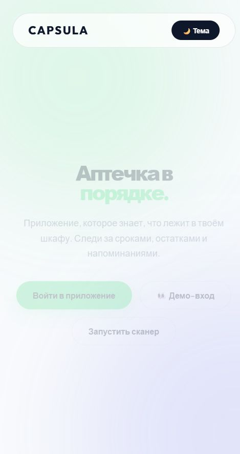
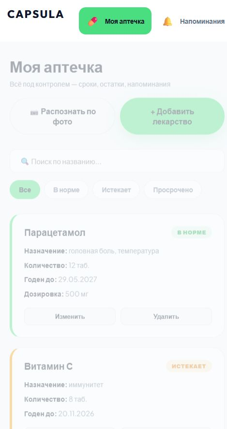
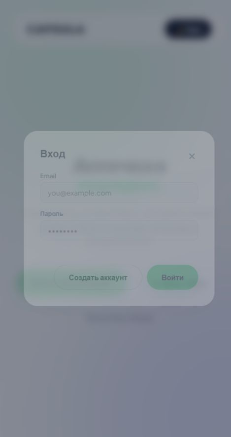

# 💊 Capsula — Онлайн-аптечка

> **Capsula** — веб-приложение для учёта домашней аптечки: отслеживание сроков годности, контроль остатков, напоминания о приёме и семейный доступ. Твоё здоровье — в цифре.

Это учебный проект, который развивается поэтапно. Сейчас реализован фронтенд и клиентская логика (авторизация и CRUD на `localStorage`); далее по плану — перенос на сервер (FastAPI + SQLite) и ИИ-распознавание.

---

## ✨ Возможности

- 🎨 **Glassmorphism-дизайн** со светлой и тёмной темой
- 🔐 **Авторизация**: регистрация, вход, хеширование пароля (SHA-256), сессии
- 👀 **Демо-вход в один клик** — сразу видно заполненное приложение
- 💊 **Управление лекарствами**: добавление, редактирование, удаление
- 🟢 **Автостатус по сроку**: «В норме» / «Истекает» (≤ 30 дней) / «Просрочено»
- 🔍 **Поиск** по названию и назначению + **фильтры** по статусу
- 🔔 **Напоминания** о приёме (время + комментарий)
- 👨‍👩‍👧 **Семейный доступ**: профили членов семьи
- 📱 **Адаптивная вёрстка** (мобильные и десктоп)

## 🖼 Скриншоты

| Лендинг | Приложение | Вход |
|---------|-----------|------|
|  |  |  |

## 🛠 Технологии

| Слой | Технологии |
|------|-----------|
| **Фронтенд** | HTML5, CSS3 (CSS-переменные, Grid/Flexbox, анимации), JavaScript (ES6+) |
| **Хранение (сейчас)** | `localStorage` (данные в браузере) |
| **Бэкенд (по плану)** | Python, FastAPI, SQLite |
| **Интеграции (по плану)** | ИИ-распознавание (Gemini Vision / GPT-4o), Telegram Bot API |

## 🚀 Запуск

Проект статический — достаточно открыть `index.html` в браузере.

Или запустить локальный сервер:

```bash
# из папки проекта
python -m http.server 8000
# открыть http://localhost:8000
```

Проект также разворачивается на **GitHub Pages** без изменений.

### 👀 Демо-доступ

Нажми **«Демо-вход»** на главной странице — приложение откроется сразу с примерами лекарств, напоминаний и членов семьи. Либо зарегистрируй свой аккаунт (данные хранятся только в твоём браузере).

## 🗂 Структура

```
aptechka/
├── index.html      # разметка: лендинг + приложение + модалки
├── style.css       # стили, темы, анимации
├── app.js          # логика: авторизация, CRUD, поиск/фильтры, напоминания, семья
├── screenshots/    # скриншоты для README
└── README.md
```

## 🗺 Дорожная карта

- [x] **Этап 1. Интерфейс** — лендинг, личный кабинет, карточки, модалки, анимации
- [x] **Авторизация (клиент)** — вход/регистрация, хеширование, сессии, демо-вход
- [x] **CRUD лекарств (клиент)** — добавление/редактирование/удаление + поиск и фильтры
- [x] **Напоминания и семья (клиент)** — профили и график приёма
- [ ] **Этап 2. Бэкенд** — FastAPI + SQLite, хеширование bcrypt, серверные сессии
- [ ] **Этап 3. CRUD через API** — перенос данных из `localStorage` в SQLite
- [ ] **Этап 4. ИИ-распознавание** — определение препарата по фото упаковки
- [ ] **Этап 5. Семейный доступ (сервер)** — общие аптечки и списки покупок
- [ ] **Этап 6. Telegram-бот** — напоминания и уведомления о сроках

## ⚠️ Важно

Текущая версия хранит данные в `localStorage` браузера — они привязаны к конкретному устройству и не синхронизируются между пользователями. Полноценный бэкенд (общая база данных) — следующий этап.
